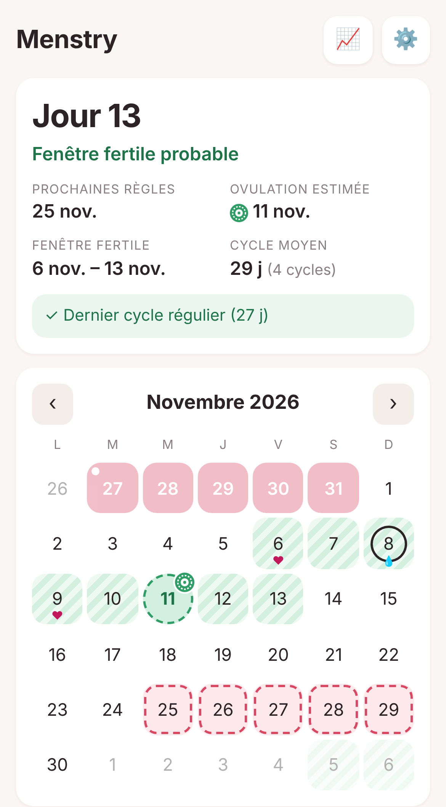
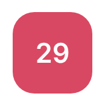
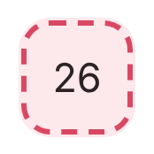
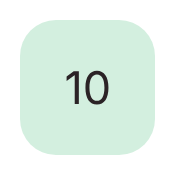
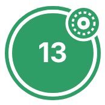
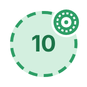
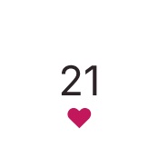
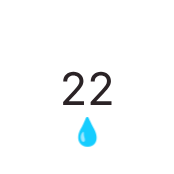
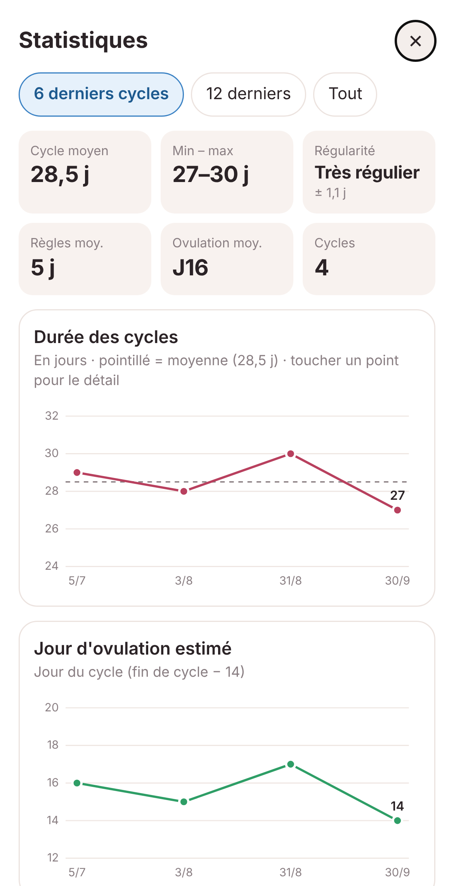

# 🌙 Menstry

Une application simple et privée pour suivre le cycle menstruel sur téléphone.

> ℹ️ **Menstry est conçue pour les cycles réguliers.** Les estimations d'ovulation et de fenêtre fertile reposent sur la régularité des cycles. L'application vérifie cette régularité à chaque nouveau cycle et signale tout écart important.

👉 **Ouvrir l'application : https://carellyme.github.io/Menstry/**

- 📅 Un calendrier pour noter les règles, les rapports et la glaire cervicale
- 🔮 L'estimation de l'ovulation et de la fenêtre fertile, en couleur
- 📈 Des statistiques et des courbes sur les cycles
- 🔒 Des données qui restent **dans le téléphone**, avec des sauvegardes **chiffrées**
- 👆 Un verrouillage par **empreinte ou Face ID**
- ⚠️ Une **alerte immédiate** en cas de cycle irrégulier

---

## 📲 Installation

L'application s'installe depuis le navigateur, sans passer par l'App Store ni le Play Store.

**Sur iPhone**
1. Ouvrir le lien ci-dessus **dans Safari**.
2. Toucher le bouton **Partager** (le carré avec une flèche).
3. Choisir **« Sur l'écran d'accueil »**.

**Sur Android**
1. Ouvrir le lien ci-dessus **dans Chrome**.
2. Toucher le menu **⋮** en haut à droite.
3. Choisir **« Installer l'application »**.

L'icône 🌙 **Menstry** apparaît alors sur l'écran d'accueil. Il faut toujours passer par cette icône plutôt que par le navigateur, car les données sont liées à l'application installée.

L'application fonctionne aussi **sans connexion internet**.

---

## 🚀 Premiers pas

1. Ouvrir les **réglages ⚙️** → **Mot de passe de sauvegarde** et choisir une phrase de 4 ou 5 mots, par exemple `lune pivoine tram cerise`. **La noter en lieu sûr.**
2. Dans les réglages, activer **Verrouillage par empreinte / Face ID**.
3. Sur le calendrier, toucher le **premier jour des dernières règles** et cocher **« Début de cycle »**.

Les prévisions apparaissent immédiatement.

---

## ✍️ Utilisation au quotidien

Toucher un jour du calendrier, ou le bouton **« + Noter aujourd'hui »**, puis cocher ce qui s'applique :

| | |
|---|---|
| 🌸 **Début de cycle** | Le 1er jour des règles. « Règles » est alors coché automatiquement. |
| 🩸 **Règles** | Chaque jour de règles |
| ♥ **Rapport** | Les jours de rapport |
| 💧 **Glaire cervicale** | Sèche, collante, crémeuse, aqueuse ou blanc d'œuf |

Chaque saisie est enregistrée immédiatement. Aucun mot de passe n'est demandé pour noter.

### Lecture du calendrier

| Aspect | Signification |
|:---:|---|
|  | **Règles notées** : case rouge pleine. Un petit point blanc en haut à gauche marque le début du cycle. |
|  | **Règles prévues** : case rose pâle, contour rouge en pointillé. |
|  | **Fenêtre fertile** d'un cycle terminé : case vert clair. |
|  | **Fenêtre fertile prévue** : case vert clair hachurée. |
|  | **Ovulation** d'un cycle terminé : rond vert foncé cerclé, avec l'icône d'ovule. |
|  | **Ovulation prévue** : rond vert clair à contour pointillé, avec l'icône d'ovule. |
|  | **Rapport** noté ce jour-là : petit cœur sous la date. |
|  | **Glaire cervicale** notée ce jour-là : goutte sous la date. |

Le jour actuel est entouré d'un cercle. En résumé : **hachuré ou en pointillé = prévision**, **couleur pleine = cycle terminé ou saisie**.

Glisser le calendrier vers la gauche ou la droite change de mois.

---

## 🔮 Calcul des prévisions

- **Durée du cycle** : moyenne des 6 derniers cycles (28 jours par défaut tant qu'aucun cycle complet n'a été noté, c'est-à-dire avant le deuxième « Début de cycle »).
- **Prochaines règles** : dernier début de cycle + durée moyenne.
- **Ovulation** : début du cycle suivant **− 14 jours**.
- **Fenêtre fertile** : de **5 jours avant** l'ovulation à **2 jours après**.

Les prévisions s'affinent à mesure que des cycles sont notés. Les valeurs par défaut sont modifiables dans les réglages.

> ⚠️ **Important** : il s'agit d'estimations statistiques. Elles ne remplacent pas un avis médical et **ne constituent pas une méthode de contraception fiable**, en particulier en cas de cycles irréguliers.

---

## ⚠️ Contrôle de la régularité

À chaque fois qu'un **« Début de cycle »** est coché, l'application analyse le cycle qui vient de se terminer. Un message s'affiche **immédiatement** si :

- le cycle s'écarte de **plus de 4 jours** de la moyenne des cycles précédents (valeur modifiable dans les réglages : « Écart toléré ») ;
- le cycle dure **moins de 21 jours ou plus de 35 jours** ;
- l'écart entre le cycle le plus court et le plus long dépasse **7 jours** sur les 6 derniers cycles ;
- le cycle dure moins de 15 jours, ce qui peut indiquer une erreur de saisie ou un saignement entre deux cycles.

Si le cycle est régulier, une courte confirmation s'affiche (« régulier ✓ »).

L'écran principal rappelle en permanence l'état du dernier cycle : **✓ Dernier cycle régulier**, ou **⚠️ Dernier cycle irrégulier**. Toucher ce message affiche le détail.

En cas d'irrégularité, les prévisions restent affichées, mais elles sont moins fiables.

---

## 📈 Statistiques

Le bouton **📈** en haut de l'écran affiche :

- le cycle moyen, le plus court, le plus long et la régularité ;
- la durée moyenne des règles et le jour moyen d'ovulation ;
- des **courbes** : durée des cycles et jour d'ovulation, cycle après cycle ;
- des **graphiques** : durée des règles et, si des rapports ont été notés, rapports par cycle ;
- **« Mes cycles »** : une vue d'ensemble, un rang par cycle, pour les comparer d'un coup d'œil ;
- un **tableau** récapitulatif (« Voir en tableau »).

Toucher un point d'une courbe, ou une barre d'un graphique, affiche le détail. L'affichage peut porter sur les 6 ou 12 derniers cycles, ou sur tout l'historique.

Les statistiques apparaissent dès que **deux débuts de cycle** ont été notés.

---

## 🔒 Données et vie privée

**Les données ne quittent jamais le téléphone en clair.**

- Elles sont enregistrées **dans le téléphone**, dans le stockage de l'application installée.
- Il n'y a **aucun serveur**, **aucun compte** à créer, **aucune publicité** et **aucun pistage**.
- Le lien de l'application ne fournit que l'application elle-même, vide. Une autre personne qui l'ouvre ne voit **aucune donnée**.
- Le **verrouillage par empreinte / Face ID** est demandé à l'ouverture, et au retour dans l'application après plus d'une minute. Le mot de passe de sauvegarde sert de solution de secours si l'empreinte ne fonctionne pas : c'est pourquoi il est demandé avant d'activer le verrouillage.

---

## 💾 Sauvegardes (indispensables)

Les données étant stockées uniquement dans le téléphone, **elles sont perdues en cas de perte du téléphone ou de suppression de l'application**, sauf si une sauvegarde existe. Deux possibilités :

### Option 1 : fichier de sauvegarde

Réglages ⚙️ → **Exporter** produit un fichier chiffré (si aucun mot de passe de sauvegarde n'existe encore, il est demandé à ce moment-là). Il peut être rangé dans les fichiers du téléphone, envoyé par e-mail ou stocké ailleurs. Il est conseillé d'en refaire un régulièrement, par exemple une fois par mois.

Pour le récupérer : Réglages ⚙️ → **Importer**, puis choisir le fichier. Les données actuelles du téléphone sont alors remplacées par celles de la sauvegarde, après confirmation.

### Option 2 : sauvegarde automatique sur Google Drive

Une fois configurée, la sauvegarde se fait **automatiquement** sur Google Drive à chaque modification, sans aucune action.

- La sauvegarde est placée dans un **dossier caché réservé à l'application**. Elle n'apparaît pas dans Drive, et l'application n'a accès à **aucun autre fichier** du Drive.
- L'icône ☁️ en haut de l'écran indique l'état : **✓** sauvegardé, **↑** en attente (la toucher lance la sauvegarde), **!** problème.
- Une fenêtre Google peut parfois s'ouvrir et se refermer brièvement : c'est normal.

La configuration prend environ 10 minutes et ne se fait qu'une fois. Voir [Configuration de Google Drive](#configuration-de-google-drive) en bas de page.

---

## 🔐 Le chiffrement, simplement

Avant de quitter le téléphone, chaque sauvegarde (fichier ou Drive) est **chiffrée** : elle est transformée en un contenu illisible, que seul le mot de passe permet de déchiffrer.

- **Personne d'autre ne peut la lire** : ni Google, ni une personne ayant piraté le compte Google, ni une personne qui trouverait le fichier.
- Le chiffrement utilise **AES-256**, le standard employé notamment par les banques.
- Le mot de passe n'est saisi **qu'une seule fois**, à la configuration. Le téléphone conserve ensuite une clé verrouillée qui lui permet de chiffrer les sauvegardes sans le redemander.
- Le mot de passe n'est **enregistré nulle part**, pas même dans le téléphone.

> ⚠️ **En cas d'oubli du mot de passe, les sauvegardes deviennent définitivement illisibles.** Aucune récupération n'est possible. Il est recommandé de le conserver en lieu sûr, par exemple dans un gestionnaire de mots de passe.

---

## 📱 Changement de téléphone

1. Installer l'application sur le nouveau téléphone (voir [Installation](#-installation)).
2. **Avec Google Drive** : Réglages ⚙️ → coller l'identifiant Google → **Connecter Drive**. L'application propose alors de restaurer la sauvegarde.
   **Avec un fichier** : Réglages ⚙️ → **Importer**, puis choisir le fichier.
3. Saisir le mot de passe de sauvegarde. C'est le seul moment où il est redemandé.

---

## ❓ Questions fréquentes

**Faut-il saisir le mot de passe à chaque utilisation ?**
Non. Seulement à la configuration, et lors d'une restauration sur un nouveau téléphone.

**Un jour a été noté par erreur.**
Toucher le jour et décocher l'élément concerné.

**Les règles sont arrivées plus tôt ou plus tard que prévu.**
Cocher « Début de cycle » le jour réel : les prévisions se recalculent automatiquement. Si un autre jour avait été coché par erreur comme début de cycle, le décocher.

**L'application affiche « Règles en retard ».**
Elle se base sur la durée moyenne des cycles. Cocher « Début de cycle » dès l'arrivée des règles.

**Comment tout effacer ?**
Réglages ⚙️ → **Effacer toutes les données**. Les sauvegardes, fichier ou Drive, ne sont pas supprimées.

---

## Configuration de Google Drive

À faire une seule fois, de préférence sur un ordinateur, depuis la [console Google Cloud](https://console.cloud.google.com) :

1. Créer un **nouveau projet**, par exemple « Menstry ».
2. Menu **API et services** → **Bibliothèque** → rechercher **Google Drive API** → **Activer**.
3. **Écran de consentement OAuth** → type **Externe** → indiquer un nom et une adresse e-mail. À l'étape **Utilisateurs test**, ajouter **l'adresse Gmail utilisée**.
4. **Identifiants** → **Créer des identifiants** → **ID client OAuth** → type **Application Web**.
   Dans **Origines JavaScript autorisées**, ajouter : `https://carellyme.github.io`
5. Copier l'**ID client**, qui se termine par `.apps.googleusercontent.com`.
6. Dans l'application : Réglages ⚙️ → **Google Drive** → coller l'ID client → **Connecter Drive**.
